# SEN3001 – Visual Programming
## Homework: GUI Programming with Tkinter

- **Student:** Melike Çeliktaş
- **Student number:** 23091440013

This homework has four small desktop programs made with Python and **Tkinter**. There are also two extra to-do list designs made with Tkinter and Pillow.

| Task | Program | File |
|---|---|---|
| 1 | Unit Converter | `task1_converter.py` |
| 2 | Calculator | `task2_calculator.py` |
| 3 | To-Do List | `task3_todo.py` |
| 4 (Bonus) | Simple Drawing App | `task4_paint.py` |
| Extra | Cute To-Do List | `Cute_TO_DO_List.py` |
| Extra | Modern To-Do List | `Modern_TO_DO_List.py` |

---

## How to Run

You need Python 3. Tkinter comes with Python. Only the two extra to-do lists need Pillow:

```bash
python3 -m pip install pillow
```

Each program is in its own folder. Open a terminal in the main project folder, go into the folder of the program, then run the file:

```bash
# Task 1 - Unit Converter
python3 converter/task1_converter.py

# Task 2 - Calculator
python3 calculator/task2_calculator.py

# Task 3 - To-Do List
python3 Todo_lists/task3_todo.py

# Task 4 - Drawing App
python3 paint/task4_paint.py

# Extra - Cute To-Do List
python3 Todo_lists/Cute_TO_DO_List.py

# Extra - Modern To-Do List
python3 Todo_lists/Modern_TO_DO_List.py
```

Run these commands from the main project folder. If you are inside a program folder, use `cd ..` to return to the main folder first.

> **Linux/Codespace note:** Tkinter opens a desktop window, so it requires a graphical desktop or a forwarded display. In a terminal-only environment you may see `no $DISPLAY` or `no display name`.

---

## Task 1 – Unit Converter

- For this program the widgets I used are:
  - **Label** for readable text
  - **Combobox** for selectable values
  - **Entry** for entering input
  - **Button** to take the information, process it and write the result on the screen
- I faced the problems:
  - Not selecting a conversion type
    - I solved this problem by giving a default conversion type with `combobox.current(0)`.
  - Entering a non-numerical value or an empty value
    - I solved this problem with a `try-except` block. If the input is not a number, the program shows a warning message.
- The converter can do these conversions: km ↔ mile, °C ↔ °F and kg ↔ lb.
- I successfully completed the project.

| Base form | Combobox selection |
|:---:|:---:|
| 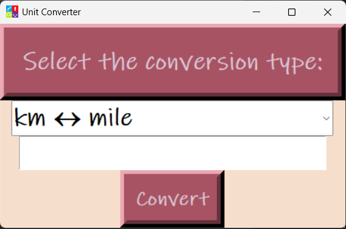 | 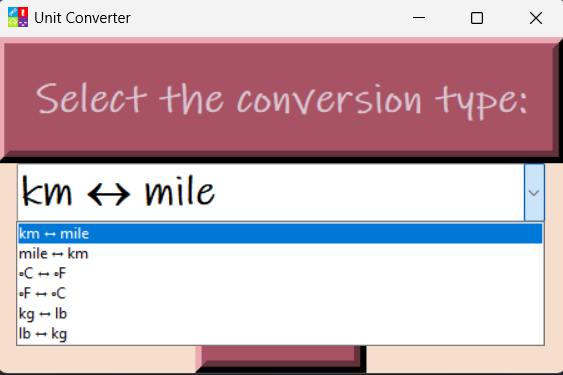 |

| Non-numeric value | Empty value |
|:---:|:---:|
| 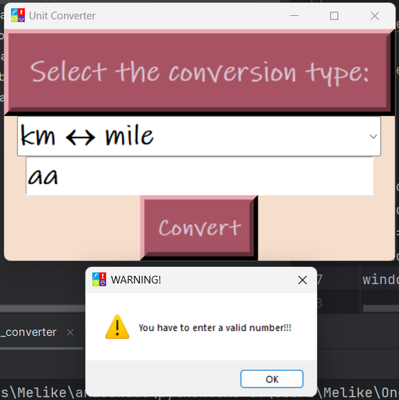 | 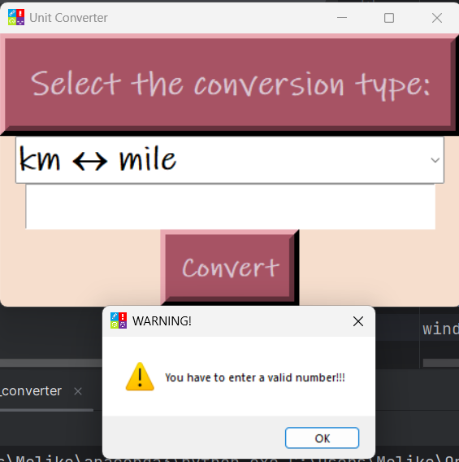 |

| Valid number in km | Valid number in °F |
|:---:|:---:|
| 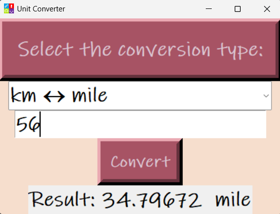 | 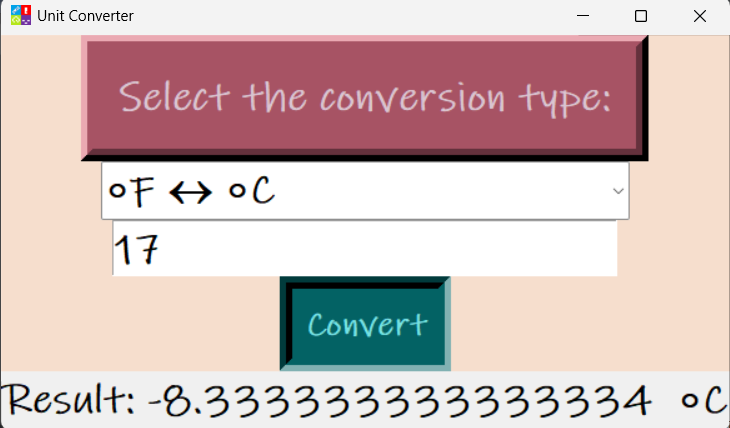 |

---

## Task 2 – Calculator

- First of all, I searched for the calculator look. Then I decided which widgets to use:
  - **Label** to see the equation on the screen
  - **Buttons** for digits, math operations, decimal point, delete all and delete the last character
  - **Frame** to keep everything organized in one container
- I faced the problems:
  - Zero division error
    - I solved this problem with error handling. When it happens, the program clears the operation and writes a short message.
  - Syntax error (invalid operation or no number)
    - I solved this problem in the same way with another `except` block.
- I prepared special functions for the buttons.
- I successfully completed the project.

| Base form | Entering some operations |
|:---:|:---:|
| 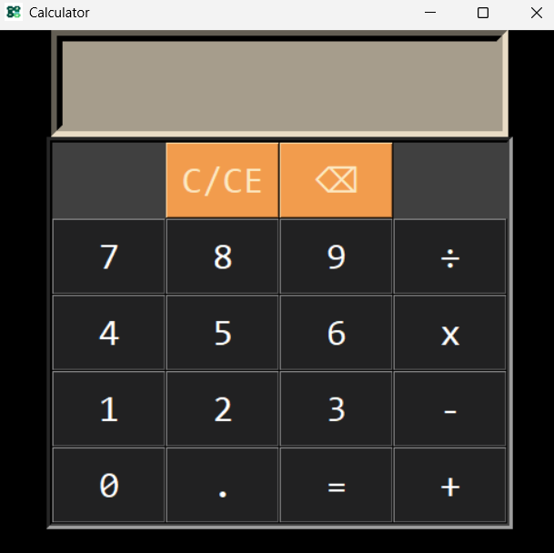 | 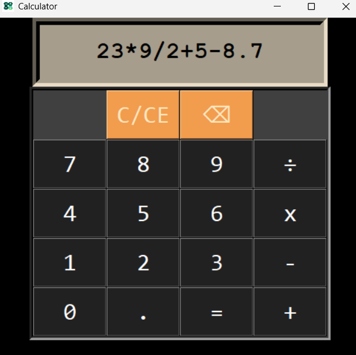 |

| Dividing by zero | After zero division error handling |
|:---:|:---:|
| 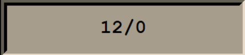 | 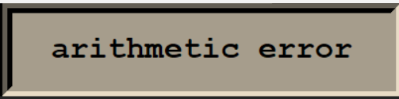 |

| Invalid operation | After invalid operation error handling |
|:---:|:---:|
| 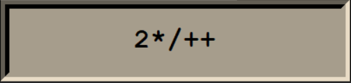 | 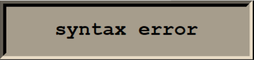 |

---

## Task 3 – To-Do List

- For this program the widgets I used are:
  - **Listbox** to make the list
  - **Frame** to keep the buttons in line
  - **Entry** for entering input
  - **Button** for the commands (Add, Delete, Done)
- I faced the problems:
  - Empty task
    - I solved this problem with the `strip()` method. If the input is empty, nothing happens. If not, the task is added to the end of the list.
  - Saving the file
    - I used the **pickle** library. The list is saved when the window is closed and loaded again when the program opens.
  - Pickle file error
    - I changed the existing file by hand and an error occurred. I solved it by adding `pickle.UnpicklingError` to the `try-except` block.
  - Marking a task in the Listbox
    - The Listbox has no such property. When the **Done** button is pushed, the program adds a ✔ icon to the task. Pushing it again removes the icon.
- I prepared special functions for the buttons.
- I successfully completed the project.

| List remembers the last items | Deleting a task |
|:---:|:---:|
| 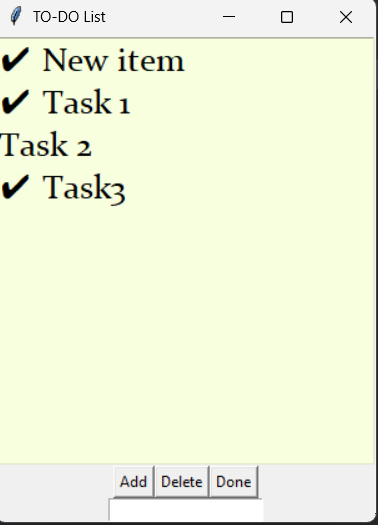 | 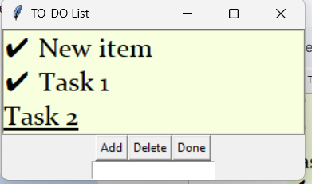 |

| Adding an item | Added list |
|:---:|:---:|
| 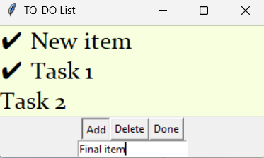 | 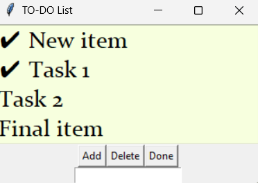 |

| Marking an item | Marked list |
|:---:|:---:|
| 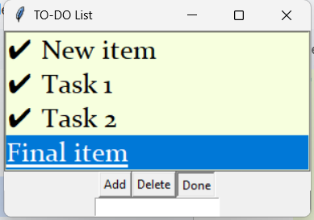 | 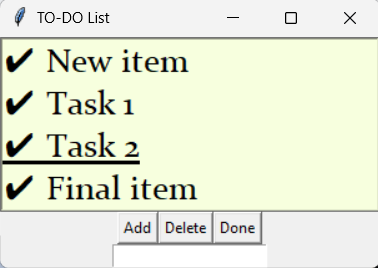 |

---

## Task 4 (Bonus) – Simple Drawing App

- For this program the widgets I used are:
  - **Canvas** to draw on the screen
  - **Frames** to keep the buttons and the scale in order
  - **Scale** to change the brush size
  - **Buttons** to change the color and clean the screen
- I faced the problems:
  - Understanding the mouse movement
    - This was the hard part and I used AI for it. The code keeps the place where the mouse is clicked, then follows where the mouse goes with `bind()`.
- I wrote the other parts myself, such as the functions, the frames and the scale.
- I am really satisfied with the final result. It has the basics of a Paint app.

| Empty page | Drawn page |
|:---:|:---:|
| 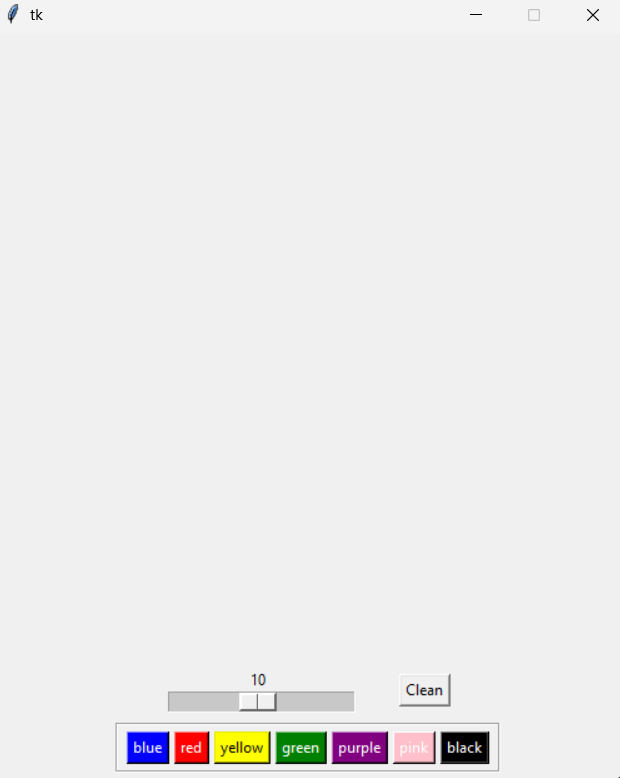 | 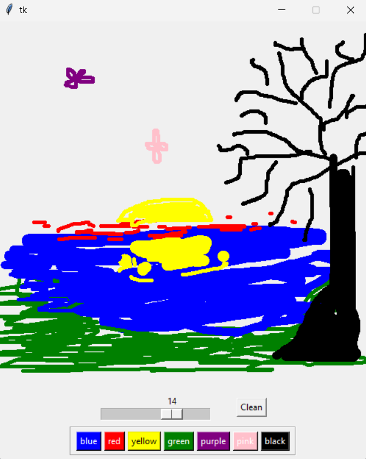 |

---

## Extra – Designed To-Do Lists

After Task 3, I made two more to-do lists with a nicer look. They use **Tkinter** and **Pillow**. In both of them you can add a task, mark it as done, delete it and scroll the list. The tasks are saved in a `.json` file.

### Cute To-Do List (`Cute_TO_DO_List.py`)

The program looks like a notebook page on a colorful background (`to_do_bg.png`). Done tasks get a check mark and a line through the text.

| Empty list | With tasks |
|:---:|:---:|
| 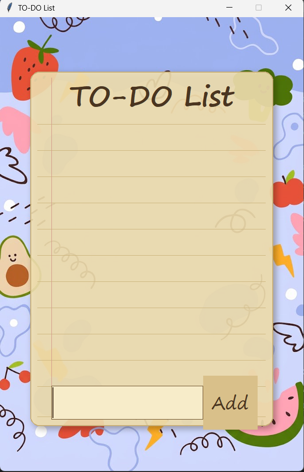 | 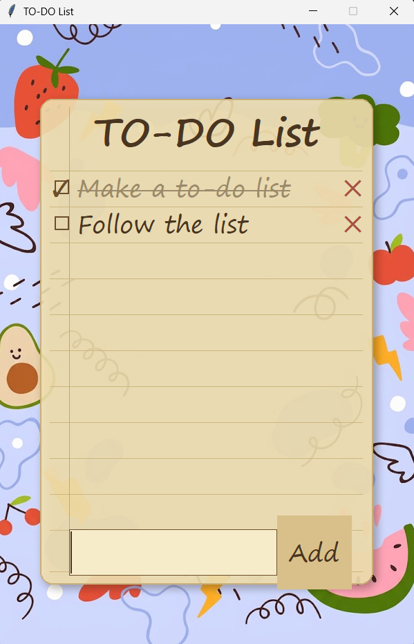 |

### Modern To-Do List (`Modern_TO_DO_List.py`)

The program has a dark glass panel on a wooden wall (`wood_light_background.png`). Every task has a light switch. When the switch is on, the task is done and a warm light glows under it. The bar at the top gets longer when more tasks are done. The texts in this version are in Turkish.

| Empty list | With tasks |
|:---:|:---:|
| 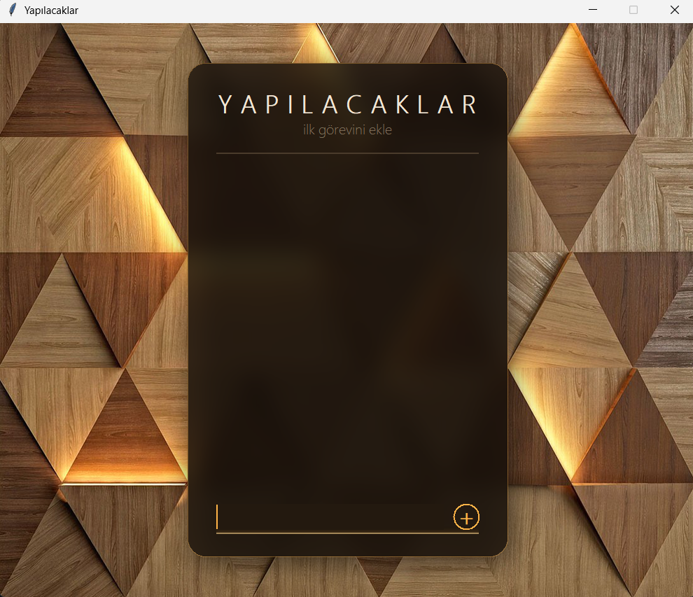 | 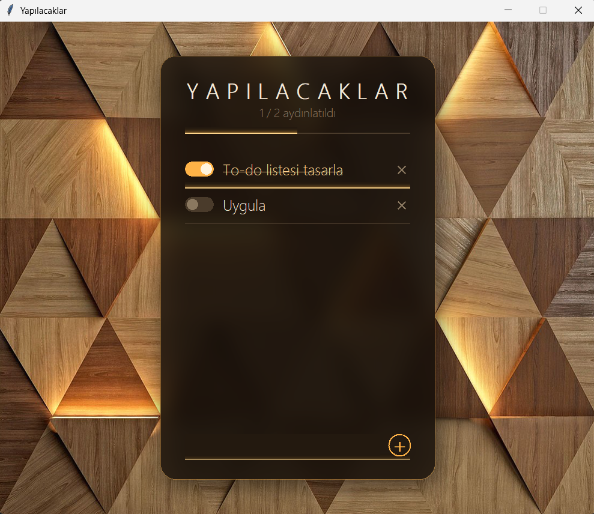 |

---

## What I Learned (Short Research)

- **Tkinter** is a Python library that shows the program on the screen in a graphical way. `mainloop()` keeps the window open and waits for events.
- **Event-driven programming** means the program reacts to events such as mouse clicks and key presses.
- **Geometry managers:** `pack()` puts widgets one after another, `grid()` uses rows and columns, `place()` uses exact coordinates. I did not mix `pack()` and `grid()` in the same container.
- **`command=` and `bind()`:** `command=` is good for buttons. `bind()` is good for keyboard and mouse events, like drawing in Task 4.
- **`messagebox`** shows information, warning and error messages to the user.

---

## Use of AI

- **Task 1 and Task 2:** No AI. I searched on the internet and watched YouTube videos.
- **Task 3:** I tried Gemini, but it gave long and unnecessary code. Copilot solved my error problem. Claude solved the rest with one prompt.
- **Task 4:** I used Claude for the mouse movement part.

---

## Project Files

```
.
├── converter/
│   ├── task1_converter.py
│   └── converter_image.png         # icon of Task 1
├── calculator/
│   ├── task2_calculator.py
│   └── calculator_image.png        # icon of Task 2
├── Todo_lists/
│   ├── task3_todo.py
│   ├── Cute_TO_DO_List.py
│   ├── Modern_TO_DO_List.py
│   ├── to_do_bg.png                # background of the cute to-do list
│   └── wood_light_background.png   # background of the modern to-do list
├── paint/
│   └── task4_paint.py
├── screenshots/                    # images used in this README
├── report.pdf
└── README.md
```